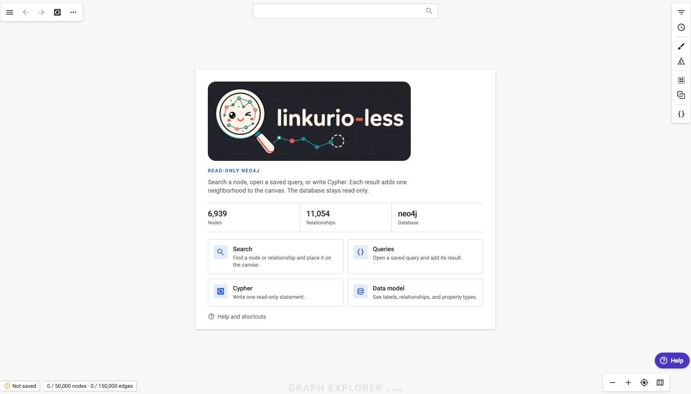
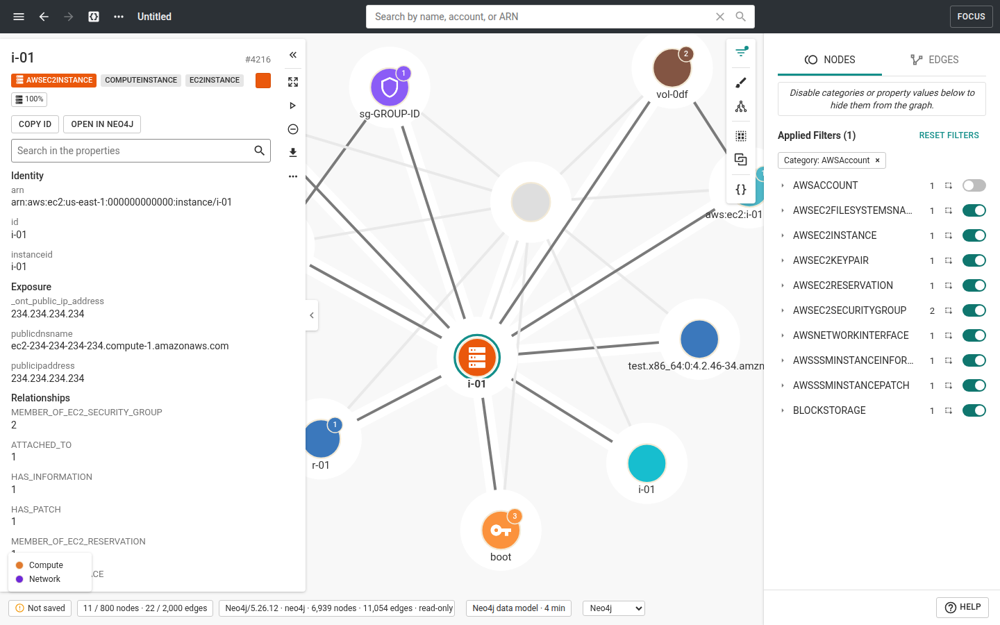
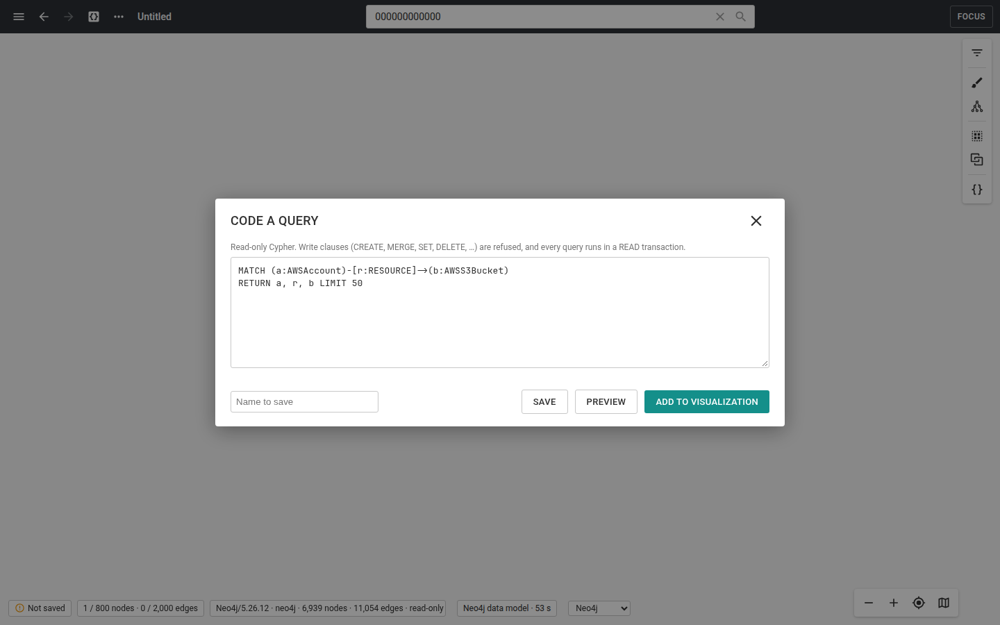

# linkurio-less


Read-only graph explorer for any Neo4j database. The page is a Linkurious-style workspace: search, expand, filter, layout, and a Cypher editor. `server.py` serves that page and a JSON API, and runs each read in a Neo4j READ transaction. Cartography is the bundled sample graph, the default styles (`data/cartography_styles.json`), and the built-in queries (`data/queries.json`).

A GraphQL endpoint is a separate source on the same page. Wiz is the first adapter. See [GraphQL source](#graphql-source).

Python 3.9+, the `neo4j` driver, and Neo4j 5. No build step. The UI is `static/`. Cytoscape holds the graph model. `static/render.js` draws it on Canvas2D. ForceAtlas2 runs in a web worker.

## What it looks like

`docs/screenshots/` is the curated set. The UI suite writes its own captures under `tests/screenshots/`, which is gitignored. `landing.png` is the empty-canvas start page. `before-after-v1.png` and `before-after-v2.png` are the older renderer comparison. `docs/compare/` holds the Linkurious comparison sheets.

The empty canvas opens on the start page.



A hub with its neighbors grouped by category. Double-click a group to load that page.


Filters hide a category and grey those nodes out.



The data-model view reads the live schema.


The Cypher editor runs one read-only query and can add the result to the graph.



## Run locally

Needs Docker. The first run installs the venv and the Neo4j 5.26 image. Later runs take about 25 seconds.

```bash
git clone https://github.com/sachafaust/linkurio-less.git && cd linkurio-less
python3 run_local.py
```

That creates `.venv/`, starts container `gx-neo4j` on 127.0.0.1 (bolt 7687, browser 7474, password `tinkerlab-test`), wipes it, loads the Cartography fixture snapshot (6,939 nodes / 11,054 relationships), and opens http://127.0.0.1:8744. Ctrl+C stops the explorer. Neo4j keeps running.

When `GRAPHQL_ENDPOINT` is unset, the same command starts container `gx-graphql` on 127.0.0.1:8791. That fixture is a small Wiz-shaped graph. The test client is `gx-graphql` and the test secret is `tinkerlab-graphql`. Pick **Wiz fixture** on the page. The fixture has no volume.

`python3 run_local.py --keep-data` leaves the database as it is. `--stop` stops the explorer and both containers. `--reset` deletes the Neo4j container, its volume, and the GraphQL fixture.

| Option | What it does |
|---|---|
| `--neo4j-uri neo4j+s://host:7687` | Use this Neo4j and leave its data alone. `NEO4J_URI` in the environment or in `.env` does the same. |
| `--neo4j-uri ... --load-data` | Wipe a local database and load the sample. Refused when the host is not local. |
| `--synthetic N` / `--both` | Load the Cartography-shaped generator, or the fixtures plus that generator. |
| `--live-scale` | Stream exactly 15,000,000 nodes and 60,000,000 edges. Needs about 16 GB of RAM for Docker and 30 GB of disk. `--nodes` and `--edges` override the totals. |
| `--max-nodes N --max-edges M` | Fixed safety ceiling. Omit both and the ceiling follows this machine's RAM. |
| `--port 8755` `--no-browser` `--detach` | Explorer port, skip the browser, run in the background. |
| `--test` | Budget tests, GraphQL tests (mocked API and the `gx-graphql` fixture), and the 33 UI checks against the fixture snapshot, then keep serving. `--no-serve` exits after the tests. |

## Your own Neo4j

Copy `.env.example` to `.env` (gitignored) or export the same variables. The environment wins over `.env`. Use a user with the reader role. A bolt URI that already contains a user or password is refused. `NEO4J_PASSWORD` may be empty when Neo4j has no password. Leave the variable out only when it is unset; `run_local.py` then asks, and Enter sends an empty password.

`python3 server.py` with no password still opens the page. Add Neo4j and Add GraphQL each write their own settings into `.env`. That file is gitignored. The password, client secret, and token are not written into `gx.local.json`, and the page does not show them again after you save. Test checks the form before it is saved. Diagnostics opens on Queries: the GraphQL document, its variables, and the response. Server and Explorer stay in the same list.

`python3 server.py --fresh` starts this run with no Neo4j and no GraphQL connection, so the page opens without waiting on a saved database and does not list a Neo4j source until one is saved. The `.env` file stays for the next normal start. Add the connection from the page.

```bash
NEO4J_URI=bolt://127.0.0.1:7687
NEO4J_USER=neo4j
NEO4J_PASSWORD=...
NEO4J_DATABASE=neo4j
```

The `neo4j` driver is not part of system Python. Install it once into `.venv` (the same environment `run_local.py` creates):

```bash
python3 -m venv .venv
.venv/bin/pip install -r requirements.txt
.venv/bin/python3 server.py    # http://127.0.0.1:8744
```

`python3 server.py` uses that `.venv` when the driver is already installed there.

`HOST`, `PORT`, and `QUIET` change the listener. The server answers a request whose Host header names localhost, an IP address, or the `HOST` address. `GX_ALLOWED_HOSTS` adds host names, separated by commas. A POST, PUT, or DELETE must send `Content-Type: application/json`, and its Origin, when present, must be the explorer itself. So a page on another site cannot save queries or start a rebuild. `GX_ENV` points at a different env file. `SEARCH_FULLTEXT_INDEX` names a full-text index. Without one, search scans at most 200,000 nodes. `python3 tools/create_fulltext_index.py --yes` creates `gx_search`.

The first launch writes a canvas working set to `gx.local.json` from CPU and RAM. The first browser open adds the GPU. Canvas budget in the status bar edits nodes, edges, neighbors per expand, and rows per query. Save writes the file for the next launch. The file is gitignored. `GX_CONFIG` points somewhere else. `MAX_NODES`, `MAX_EDGES`, `EXPAND_LIMIT`, and `CYPHER_ROW_LIMIT` fix the ceiling when you want one.

## GraphQL source

The page shows one source at a time. Search, expand, filters, layout, the data model, and Queries follow that source. Neo4j opens the Cypher library. A Wiz source opens the two graph searches in `data/wiz-queries.json` (internet-exposed EC2 instances, and security groups open to `0.0.0.0/0`). Cypher stays on Neo4j. A generic endpoint has no saved queries. GraphQL results stay in the GraphQL view. Wiz is the first adapter. Search builds `graphSearch` from the tenant schema and sends the query object as a `$query` variable. Every query object carries `type` at every level. When you choose no entity type, the type is `ANY`. On a Wiz tenant, `where` is the opaque scalar `GraphPropertyPredicate`. The explorer sends it as JSON. Wiz does not check its keys, so a misspelt property returns no result. A name search with no entity type uses `cloudResourcesV2(filterBy: {search})`, because `ANY` with a name filter takes more than 100 s. A source scoped to one project uses that search only when its filter takes `projectId`. Otherwise it asks for an entity type. With no entity type, a property filter is an `EQUALS` on `ANY`, which the tenant answers in about a second. A name and a property together need an entity type. An entity loads by `_vertexID`, because `id` matches nothing. Expand anchors the outer entity by `_vertexID` and reads the neighbors from `with`. The relationship type is `ANY` unless you choose one. A saved query that filters on a property key with a dot, such as `accessibleFrom.internet`, passes `where` as a `$where: GraphPropertyPredicate` variable. GraphQL cannot parse that key inline. A saved query draws its edges from its own query tree. `graphSearch` returns paths that list the levels with `select: true`, so the explorer links each entity to its nearest selected ancestor in the tree. A `related (via unselected)` edge is dashed, and it means the two entities link through a level that the query did not select. When the explorer cannot read the tree, or a path does not fit it, that path draws no edges and the page says the edges are not known. `quick` goes with the request when the tenant publishes it. When introspection lists no `graphSearch` arguments (the `gx-graphql` fixture), the explorer keeps the older `$query: GraphEntityQueryInput!` documents. A request that gets no answer within 30 s fails at once with HTTP 504 and is not retried. A Wiz tenant reads its search shape from a few `__type` queries (about 0.4 MB and 1-2 s). Full introspection is 11 MB, takes about 20 s, and is rate limited. Search, expand, the node total, and `/api/schema` use that shape, so the Wiz `/api/schema` has no categories. The data-model window asks `/api/schema?full=1` for full introspection, with a longer timeout (`GRAPHQL_SCHEMA_TIMEOUT`, 90 s, at most 600 s). A probe that times out or gets HTTP 401 or 5xx does not fall back to full introspection, and the failure is kept for 30 s so each call does not send it again. The neighbor summary for several nodes sends one `graphSearch` per node at the same time, up to `GRAPHQL_MAX_INFLIGHT`, and merges the answers in node order. The node total on a Wiz source is one `graphSearch` `totalCount`. Relationship totals stay unknown. A generic endpoint exposes the data model from introspection and has no instance search until an adapter exists. `python3 run_local.py` starts the local `gx-graphql` fixture when `GRAPHQL_ENDPOINT` is unset, and `python3 tests/test_graphql.py` checks that fixture when Docker is running. The same run drives search, saved queries, expand, filters, and Diagnostics in a headed browser against a mock that models the live Wiz contract.

Set the endpoint in the environment, in `.env`, or with Add GraphQL on the page. Wiz takes `GRAPHQL_CLIENT_ID` and `GRAPHQL_CLIENT_SECRET` and returns an access token from the Wiz token host for its offering: Wiz (`wiz.io`) or Wiz for Government (`wiz.us`). `WIZ_OFFERINGS` in `graphql_source.py` names both, and the page reads that table. The body is form fields: `grant_type=client_credentials`, `client_id`, `client_secret`, and `audience=wiz-api`. The GraphQL call sends `Authorization: Bearer` and does not send the client id. A bearer you already have can be saved as `GRAPHQL_TOKEN` when there is no client secret. `GRAPHQL_AUTH_URL` overrides the auth host. The secret and the token stay in the gitignored file or in the environment. `gx.local.json` can name the endpoint and the variable that holds the token. A token or client secret in that file is removed on startup.

```bash
GRAPHQL_ENDPOINT=https://api.<region>.app.wiz.io/graphql
GRAPHQL_CLIENT_ID=...
GRAPHQL_CLIENT_SECRET=...
GRAPHQL_ADAPTER=wiz
```

Or a `graphql` list in `gx.local.json`:

```json
"graphql": [
  {"id": "wiz", "label": "Wiz", "endpoint": "https://api.<region>.app.wiz.io/graphql", "adapter": "wiz", "token_env": "GRAPHQL_TOKEN", "project_id": "*"}
]
```

`GRAPHQL_ENDPOINT` overrides a file entry with the same id. `GRAPHQL_LABEL`, `GRAPHQL_ID`, `GRAPHQL_TOKEN_ENV` (default `GRAPHQL_TOKEN`), and `GRAPHQL_PROJECT_ID` (default `*`) are optional. On a `wiz.io` host the adapter defaults to `wiz`. Any other host defaults to `generic`.

The client sends queries only. A mutation is refused before the request is built. HTTP 401 with a client id and secret requests a new access token once and retries. The page says "token expired" only when the API says the token is expired. Other refusals keep the HTTP status. HTTP 429 backs off, and `GRAPHQL_MAX_INFLIGHT` caps concurrent requests (default 4). The data model is the live introspection schema: every object type, field, and relationship, with scalar fields as properties. Search and expand load one page at a time. Diagnostics keeps the GraphQL document and its variables, and removes passwords, client secrets, and bearer tokens. The client id stays in the connection form.

## Saved queries

Open Queries on the right toolbar. The panel lists the built-in queries first, then your own queries for the open connection. Hover a row to Run, Edit, Duplicate, or Delete it. A click on the row runs it. The search box filters by name, tag, and description.

New query opens the editor for Neo4j (Cypher) and for Wiz (a graph-search document plus a variables JSON object). Validate runs the read-only check and then the syntax check. On Neo4j it sends `EXPLAIN` in a read transaction, which reads no data. On Wiz it checks the braces and the definitions, and the tenant checks the fields when Preview runs. Preview runs the query and shows the counts, and it adds nothing to the canvas. Save and run saves the query and adds its result.

The server refuses a write clause, a mutation, a GraphQL document that is not well formed, a body over 100 KB, or variables that are not a JSON object. `NaN` and `Infinity` are not JSON, so variables that hold them are refused too. It uses the same message as at run time. A generic GraphQL source has no saved queries, because its adapter cannot run documents.

Your queries live in `gx.queries.json`, next to `gx.local.json`. `GX_QUERIES` names another path. Git ignores the file, and the server writes it with mode 0600. Two explorers can share the file. Each change takes a lock on `gx.queries.json.lock` and writes a temporary file with its own name.

The file holds one list per connection: a Neo4j URI and database, or a GraphQL endpoint, adapter, and project. The key is a hash, so two connections never share a list. The file never holds a password or a token.

- Each built-in has an `id` in `data/queries.json` or `data/wiz-queries.json`. The page id is `builtin:<file>:<id>`. An entry with no `id` takes a slug of its name. A new entry or a removed entry does not move the other ids.
- Editing a built-in query saves your own copy and hides the built-in. A later `git pull` that changes `data/queries.json` does not overwrite your edit. Deleting that copy shows the built-in again.
- Delete on a built-in hides it. The three-dot menu has Restore built-in queries.
- Delete asks first, and the toast offers Undo.
- The three-dot menu also has Import and Export. Export writes a JSON array of your queries. Import adds each valid entry and lists the entries it skipped, with the reason. One import has at most 1,000 entries.
- Queries that an older page saved in this browser (`gx:queries`) move to the server store on the first open of a Neo4j connection. The page removes the browser copy after the server confirms.

## Schema cache

The data model is slow to build. A 15M-node Neo4j takes about 80 s, and a full Wiz introspection takes about 20 s and is rate limited. The explorer saves each data model in `.cache/`, one JSON file per connection, so a restart on a known connection starts at once. The folder is gitignored, each file is mode 0600, and `GX_CACHE_DIR` moves it.

- **Key.** A Neo4j entry belongs to one URI, database, user, and server version. A GraphQL entry belongs to one endpoint, adapter, project, and credential. The credential is a hash of the client id (or of the token when there is no client secret). No password, token, or secret is saved. A payload with a string value that looks like one is served and not saved, and the cache line says why. Property names such as `password` or `token` are not values, so they do not stop the save.
- **What is saved.** The Neo4j data model, the Wiz search shape, and the full Wiz introspection. Search results, expand pages, and node lookups are not saved.
- **Freshness.** A saved copy is served at once. When it is older than `GX_CACHE_MAX_AGE` (24 h), the server rebuilds it in the background and swaps it in. A failed rebuild keeps the old copy and logs the error in Diagnostics. A Neo4j count store that names a new label or relationship type starts a rebuild too.
- **Wiz rate limit.** Each HTTP 429 sets a cool-down from its `Retry-After`, the last one too. A background rebuild waits it out. The shape and the full introspection rebuild at least `GX_CACHE_GAP` seconds apart (20). The spacing belongs to the endpoint, so a Data connection save keeps it.
- **Recovery.** A corrupt file, an unreadable file, or a file from an older cache version is ignored and rebuilt. A read-only or full disk turns the disk cache off with one log line, and the data model stays in memory.

The landing card and the data-model window name the entry and its age, for example "Neo4j data model cached 3 h ago (built in 80 s)". On Wiz, the landing card shows the search shape and the data-model window shows the full schema. Each has its own Refresh button. The age moves forward while the page is open. Refresh rebuilds in the background, and a toast says when it is done. Diagnostics has Clear cache. `GET /api/cache` lists the saved copies, `POST /api/cache/refresh` with `{"what": "schema"}` or `{"what": "all"}` rebuilds now, and `POST /api/cache/clear` drops the files for the active source.

## API

The page calls these JSON endpoints on the same host. `POST /api/cypher` takes one read-only Cypher statement and returns its nodes, relationships, and rows. A statement with no `LIMIT` is capped at the working set.

| Method | Path | Returns |
|---|---|---|
| GET | `/api/status` | connection, counts, working set, safety ceiling, active source |
| GET | `/api/sources` | sources you can pick. The token is omitted |
| POST | `/api/source` | `{"id":"wiz"}` switches the active source |
| GET | `/api/connection` | Neo4j and GraphQL settings. The password, client secret, and token are omitted |
| POST | `/api/connection` | saves one connection into `.env` |
| POST | `/api/connection/test` | checks the form and does not save it |
| GET | `/api/diagnostics` | server and explorer log lines, with secrets removed |
| GET | `/api/schema` | labels, relationship types, counts, and how old the saved copy is. `?refresh=1` rebuilds it |
| GET | `/api/cache` | saved data models for the active source: built at, age, build time, size, rebuild running |
| POST | `/api/cache/refresh` | `{"what":"schema"}` or `{"what":"all"}` rebuilds in the background and returns at once |
| POST | `/api/cache/clear` | drops the saved data models for the active source |
| GET | `/api/styles` | colors, icons, captions |
| GET | `/api/queries` | built-in and saved queries for the active source, each with `id`, `builtin`, and `editable` |
| POST | `/api/queries` | saves a new query for the active connection |
| PUT | `/api/queries/<id>` | changes a saved query. A built-in id saves a copy and hides the built-in |
| DELETE | `/api/queries/<id>` | deletes a saved query, or hides a built-in |
| POST | `/api/queries/validate` | runs the read-only check on a query body and saves nothing |
| POST | `/api/queries/restore-builtins` | shows the hidden built-in queries again. `{"ids": [...]}` limits it to those ids |
| GET | `/api/queries/export` | the saved queries of the active connection as a JSON array |
| POST | `/api/queries/import` | adds a JSON array of queries and reports `added` and `skipped` |
| POST | `/api/graphql` | one read-only GraphQL query on the active GraphQL source |
| GET | `/api/search` | nodes or relationships matching a string |
| POST | `/api/nodes` | nodes by element id |
| POST | `/api/neighbors` | neighbor counts for the selection |
| POST | `/api/expand` | one page of neighbors |
| POST | `/api/edges-between` | relationships among the nodes on screen |
| POST | `/api/cypher` | one read-only Cypher query |
| POST | `/api/budget/suggest` | a working set for the reported CPU, RAM, and GPU |
| POST | `/api/budget/refine` | writes the browser GPU into an automatic working set once |
| POST | `/api/budget` | saves the working set for the next launch |

## Sample data

`seed_cartography.py` reads the same environment and `.env`. It refuses a URI that is not localhost. `--wipe` empties that local database first.

```bash
python3 seed_cartography.py --wipe --fixtures                 # snapshot in data/cartography-fixtures.json.gz
python3 seed_cartography.py --wipe                            # 1,099 synthetic nodes
python3 seed_cartography.py --live-scale --dry-run            # print the 15M / 60M plan
```

Rebuild the snapshot from a Cartography checkout with `sh tools/cartography_fixtures/regenerate.sh`.

## Where things live

| Path | Role |
|---|---|
| `server.py` | HTTP server, source switch, and read-only Cypher |
| `graphql_source.py` | GraphQL client, introspection model, and the Wiz adapter |
| `neo4j_env.py` | `NEO4J_*` from the environment, then `.env` |
| `query_store.py` | saved queries per connection in `gx.queries.json` |
| `schema_cache.py` | the saved data models in `.cache/` |
| `static/app.js` | UI |
| `static/render.js` | Canvas2D renderer |
| `run_local.py` | venv, Docker Neo4j, GraphQL fixture, sample load, server |
| `tools/graphql_fixture.py` | Wiz-shaped fixture served by container `gx-graphql` |
| `data/cartography_styles.json` | category color, icon, caption |
| `data/queries.json` | Neo4j Cypher library |
| `data/wiz-queries.json` | Wiz graph-search library |
| `docs/screenshots/` | Curated UI captures. The suite writes gitignored `tests/screenshots/` |
| `docs/compare/` | Linkurious comparison sheets |
| `tests/test_budget.py` | working-set math and a tiny read-only server check |
| `tests/test_graphql.py` | mocked GraphQL API, paging, the source switch, a headed tenant page, and the Docker fixture |
| `tests/test_neo4j_env.py` | credential loading |
| `tests/test_queries.py` | the saved-query store: source keys, validation, built-ins, file safety, import and export |
| `tests/test_disk_cache.py` | the schema cache: restart reuse, refresh, key isolation, no host or secret on disk, the cache API, and a headed page |
| `tests/test_privacy.py` | the privacy scan of every tracked file. It must pass before a push |
| `tests/run_ui_tests.py` | Playwright UI suite. Set `CHROME` to override the browser |
