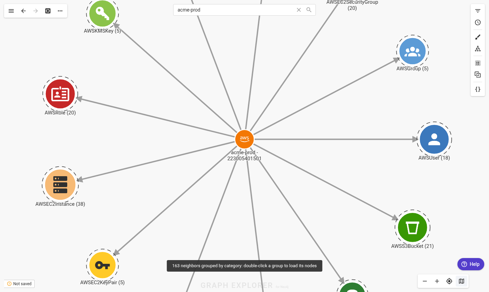
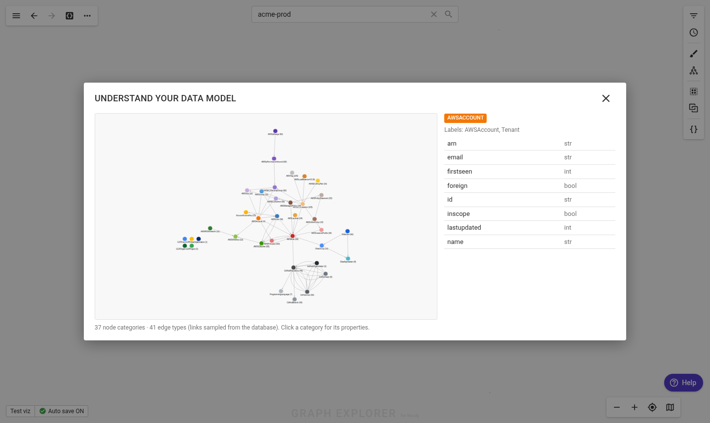

# linkurio-less


Read-only graph explorer for any Neo4j database. The page is a Linkurious-style workspace: search, expand, filter, layout, and a Cypher editor. `server.py` serves that page and a JSON API, and runs each read in a Neo4j READ transaction. Cartography is the bundled sample graph, the default styles (`data/cartography_styles.json`), and the built-in queries (`data/queries.json`).

Python 3.9+, the `neo4j` driver, and Neo4j 5. No build step. The UI is `static/`. Cytoscape holds the graph model. `static/render.js` draws it on Canvas2D. ForceAtlas2 runs in a web worker.

## What it looks like

`docs/screenshots/` holds the UI-suite captures. `python3 run_local.py --test` rewrites the `app-*.png` files. `landing.png` is the empty-canvas start page. `before-after-v1.png` and `before-after-v2.png` are the older renderer comparison. `docs/compare/` holds the Linkurious comparison sheets.

The empty canvas opens on the start page.


A hub with its neighbors grouped by category. Double-click a group to load that page.



Filters hide a category and grey those nodes out.


The data-model view reads the live schema.



The Cypher editor runs one read-only query and can add the result to the graph.


## Run locally

Needs Docker. The first run installs the venv and the Neo4j 5.26 image. Later runs take about 25 seconds.

```bash
git clone https://github.com/sachafaust/linkurio-less.git && cd linkurio-less
python3 run_local.py
```

That creates `.venv/`, starts container `gx-neo4j` on 127.0.0.1 (bolt 7687, browser 7474, password `tinkerlab-test`), wipes it, loads the Cartography fixture snapshot (6,939 nodes / 11,054 relationships), and opens http://127.0.0.1:8744. Ctrl+C stops the explorer. Neo4j keeps running.

`python3 run_local.py --keep-data` leaves the database as it is. `--stop` stops the explorer and the container. `--reset` deletes the container and its volume.

| Option | What it does |
|---|---|
| `--neo4j-uri neo4j+s://host:7687` | Use this Neo4j and leave its data alone. `NEO4J_URI` in the environment or in `.env` does the same. |
| `--neo4j-uri ... --load-data` | Wipe a local database and load the sample. Refused when the host is not local. |
| `--synthetic N` / `--both` | Load the Cartography-shaped generator, or the fixtures plus that generator. |
| `--live-scale` | Stream exactly 15,000,000 nodes and 60,000,000 edges. Needs about 16 GB of RAM for Docker and 30 GB of disk. `--nodes` and `--edges` override the totals. |
| `--max-nodes N --max-edges M` | Fixed safety ceiling. Omit both and the ceiling follows this machine's RAM. |
| `--port 8755` `--no-browser` `--detach` | Explorer port, skip the browser, run in the background. |
| `--test` | Budget tests plus the 33 UI checks, then keep serving. `--no-serve` exits after the tests. |

## Your own Neo4j

Copy `.env.example` to `.env` (gitignored) or export the same variables. The environment wins over `.env`. Use a user with the reader role. A bolt URI that already contains a user or password is refused.

```bash
NEO4J_URI=bolt://127.0.0.1:7687
NEO4J_USER=neo4j
NEO4J_PASSWORD=...
NEO4J_DATABASE=neo4j
```

```bash
python3 server.py    # http://127.0.0.1:8744
```

`HOST`, `PORT`, and `QUIET` change the listener. `GX_ENV` points at a different env file. `SEARCH_FULLTEXT_INDEX` names a full-text index. Without one, search scans at most 200,000 nodes. `python3 tools/create_fulltext_index.py --yes` creates `gx_search`.

The first launch writes a canvas working set to `gx.local.json` from CPU and RAM. The first browser open adds the GPU. Canvas budget in the status bar edits nodes, edges, neighbors per expand, and rows per query. Save writes the file for the next launch. The file is gitignored. `GX_CONFIG` points somewhere else. `MAX_NODES`, `MAX_EDGES`, `EXPAND_LIMIT`, and `CYPHER_ROW_LIMIT` fix the ceiling when you want one.

## API

The page calls these JSON endpoints on the same host. `POST /api/cypher` takes one read-only Cypher statement and returns its nodes, relationships, and rows. A statement with no `LIMIT` is capped at the working set.

| Method | Path | Returns |
|---|---|---|
| GET | `/api/status` | connection, counts, working set, safety ceiling |
| GET | `/api/schema` | labels, relationship types, counts |
| GET | `/api/styles` | colors, icons, captions |
| GET | `/api/queries` | built-in saved queries |
| GET | `/api/search` | nodes or relationships matching a string |
| POST | `/api/nodes` | nodes by element id |
| POST | `/api/neighbors` | neighbor counts for the selection |
| POST | `/api/expand` | one page of neighbors |
| POST | `/api/edges-between` | relationships among the nodes on screen |
| POST | `/api/cypher` | one read-only Cypher query |
| POST | `/api/budget/suggest` | a working set for the reported CPU, RAM, and GPU |
| POST | `/api/budget/refine` | writes the browser GPU into an automatic working set once |
| POST | `/api/budget` | saves the working set for the next launch |

## Sample data

`seed_cartography.py` reads the same environment and `.env`. It refuses a URI that is not localhost. `--wipe` empties that local database first.

```bash
python3 seed_cartography.py --wipe --fixtures                 # snapshot in data/cartography-fixtures.json.gz
python3 seed_cartography.py --wipe                            # 1,099 synthetic nodes
python3 seed_cartography.py --live-scale --dry-run            # print the 15M / 60M plan
```

Rebuild the snapshot from a Cartography checkout with `sh tools/cartography_fixtures/regenerate.sh`.

## Where things live

| Path | Role |
|---|---|
| `server.py` | HTTP server and read-only Cypher |
| `neo4j_env.py` | `NEO4J_*` from the environment, then `.env` |
| `static/app.js` | UI |
| `static/render.js` | Canvas2D renderer |
| `run_local.py` | venv, Docker Neo4j, sample load, server |
| `data/cartography_styles.json` | category color, icon, caption |
| `data/queries.json` | built-in queries |
| `docs/screenshots/` | UI-suite captures |
| `docs/compare/` | Linkurious comparison sheets |
| `tests/test_budget.py` | working-set math and a tiny read-only server check |
| `tests/test_neo4j_env.py` | credential loading |
| `tests/run_ui_tests.py` | Playwright UI suite. Set `CHROME` to override the browser |
